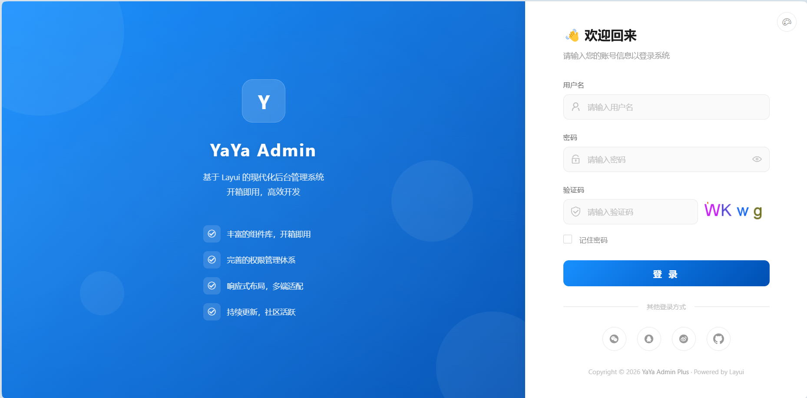
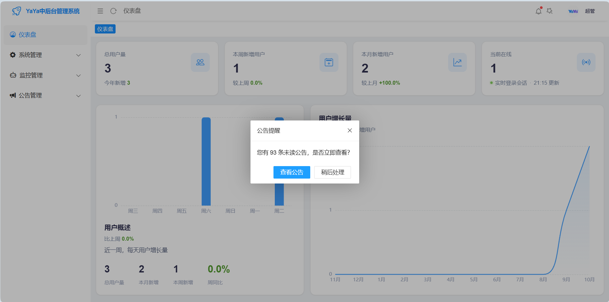
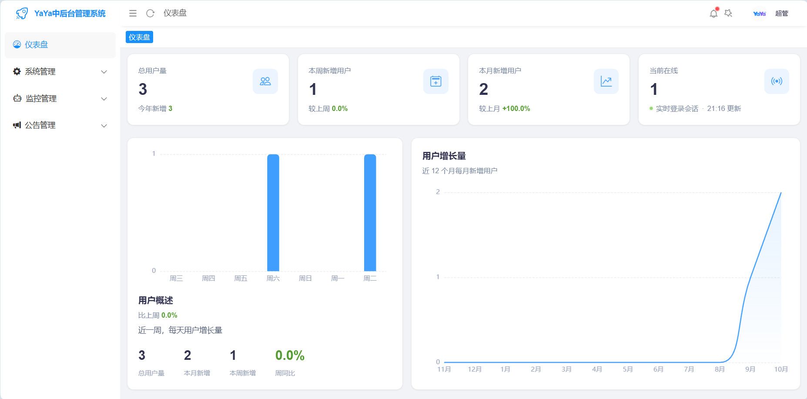
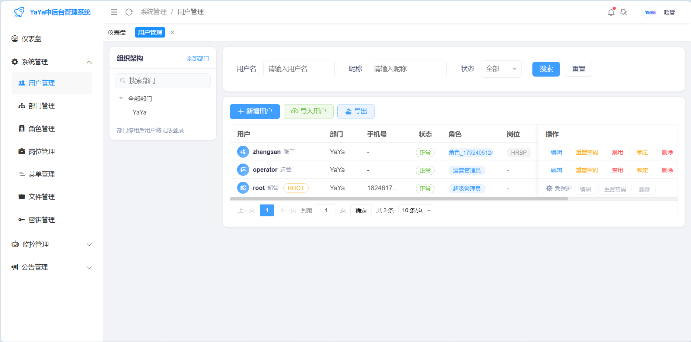
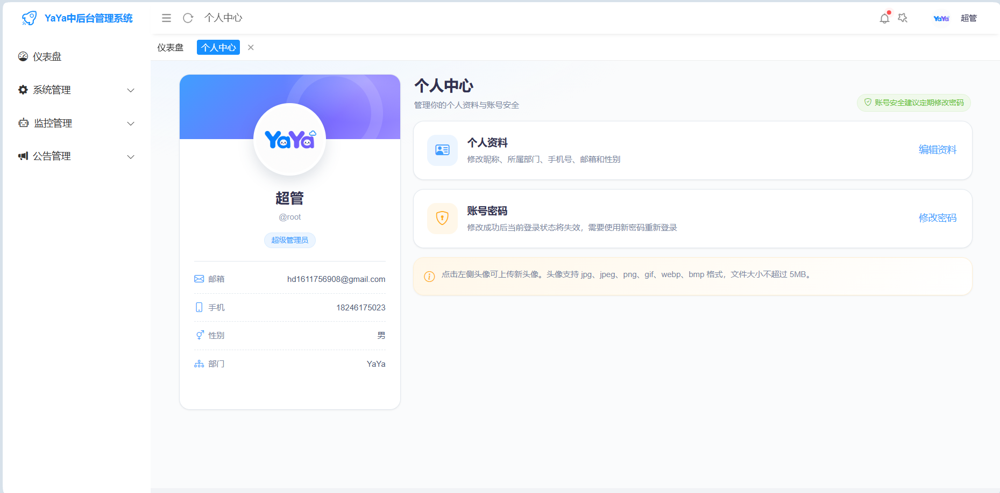
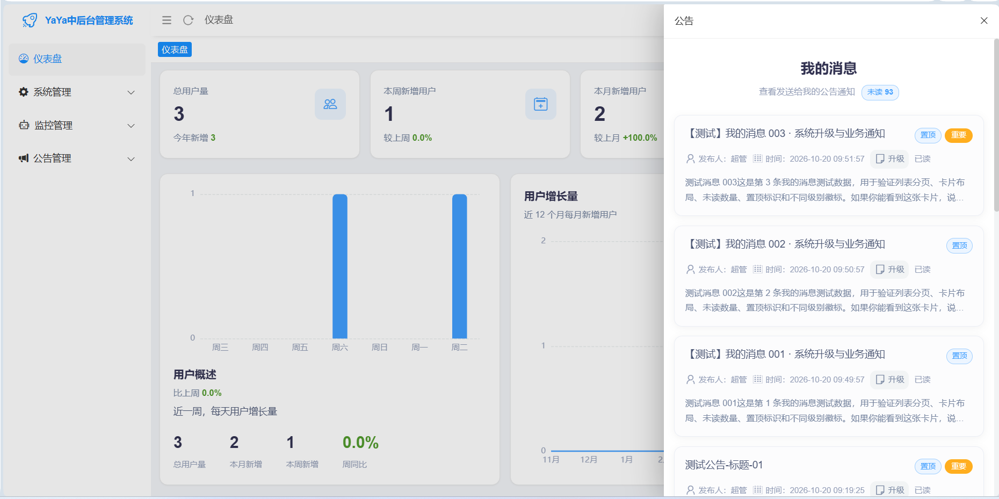
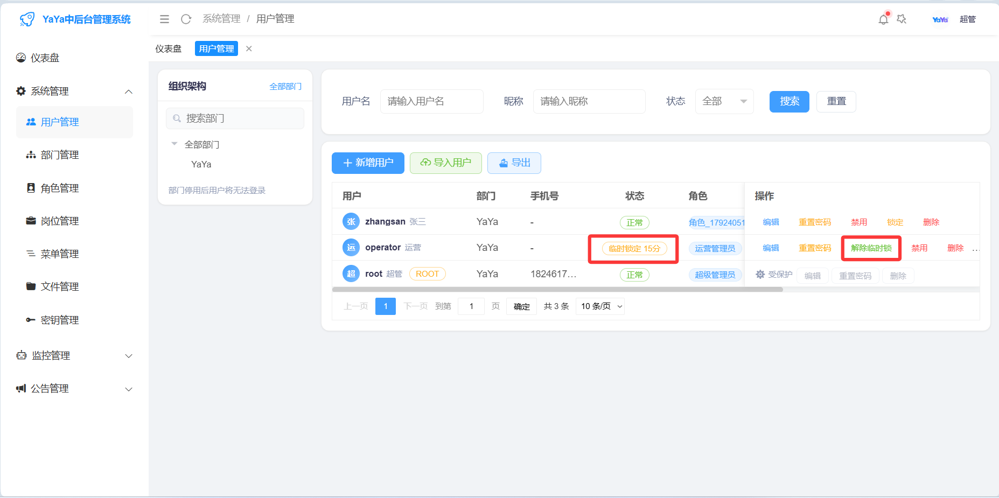
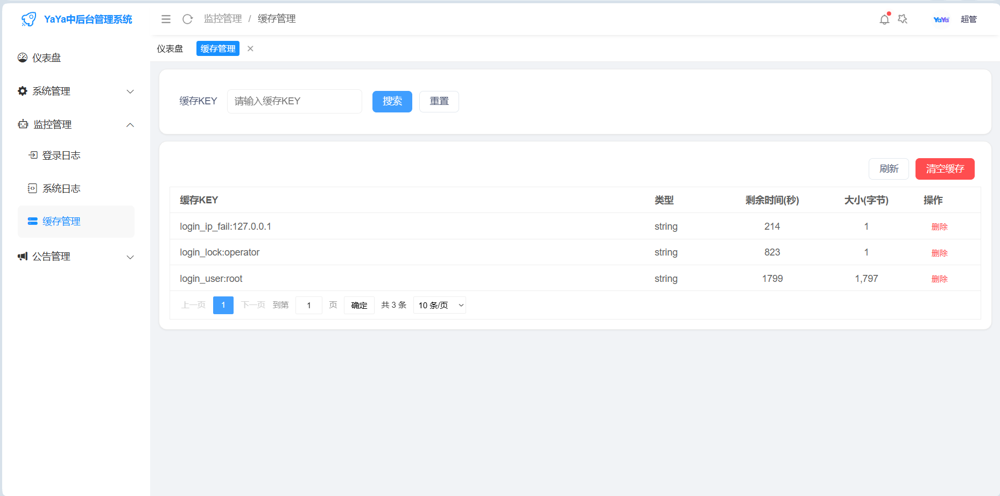

<div align="center">
    
</div>

## <div align="center"> 极简中后台管理系统 </div>
<div align="center">
	<a href="https://gitee.com/ukoko/yaya-boot-plus"></a>
    <a href="https://gitee.com/ukoko/yaya-boot-plus"></a>
	<a href="https://gitee.com/ukoko/yaya-boot-plus"></a>
	<a href="https://gitee.com/ukoko/yaya-boot-plus"></a>
	<a href="https://gitee.com/ukoko/yaya-boot-plus"></a>
    <a href="https://gitee.com/ukoko/yaya-boot-plus"></a>
</div>

## 介绍

一款适合中小企业的开源免费的中后台管理系统，前端基于[YaYa-Layui-Admin-Plus](https://gitee.com/ukoko/yaya-layui-admin-plus)模板，后端基于[SpringBoot4.x.x](https://spring.io)框架，数据库采用[MySQL8](https://www.mysql.com)/[PostgreSQL18](https://www.postgresql.org)双库兼容模式，可以覆盖大部分的开发场景。

---
## 预览
<table>
<tr>
<td colspan="2"></td>
<td colspan="2"></td>
</tr>
<tr>
<td colspan="2"></td>
<td colspan="2"></td>
</tr>
<tr>
<td colspan="2"></td>
<td colspan="2"></td>
</tr>
<tr>
<td colspan="2"></td>
<td colspan="2"></td>
</tr>
</table>

* [预览地址](http://106.14.27.178/)(账号/密码: root/123456)
* [使用文档](使用手册.md)

---
## 日志

```
🚀2026年10月22 YaYa中后台管理系统(yaya-boot-plus)发布,前端+后端
```
---