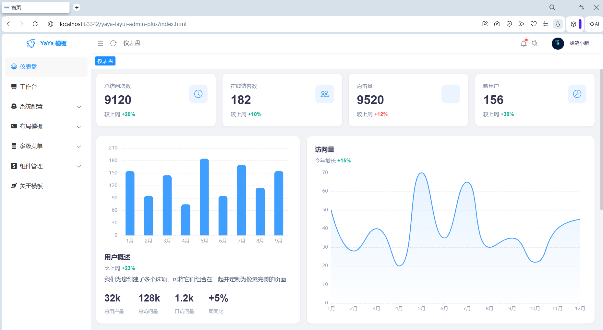
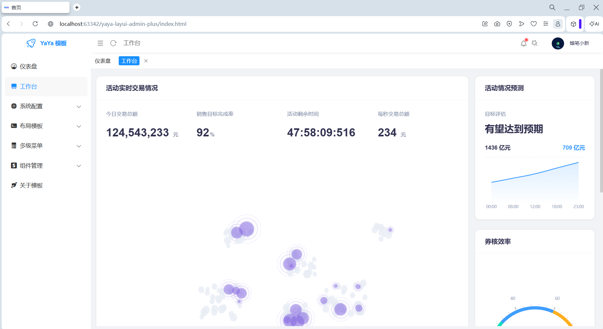
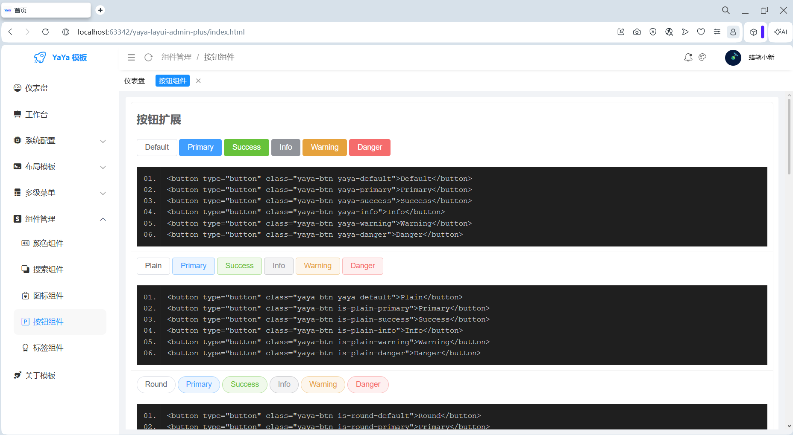
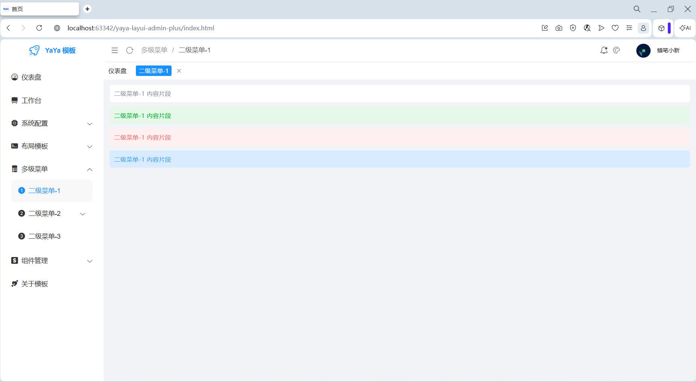

    

### 
 基于LayUI实现的一套极简前端管理模板 

	
    
	
    

## 介绍
`YaYa-Layui-Admin-Plus`是基于[LayUI](https://layui.dev/)实现的前端管理模板，项目采用原始单页独立的构建方式，不依赖脚手架，开发者只需要掌握简单的HTML/CSS/JS基础知识即可快速上手，开发和维护成本极低。

## 设计初衷

> 🌟 需要一套最简单的技术栈，来降低前端的学习、开发和维护成本。

## 页面预览

<table>
    <tr> <td style="width:50%;">  </td><td style="width:50%;"></td></tr>
    <tr> <td style="width:50%;">  </td><td style="width:50%;"> </td></tr>
</table>

* [在线预览](http://106.14.27.178/)
* [使用文档](https://hs-an-yue.github.io/2026/08/23/yaya/yaya-layui-admin-plus%E5%BF%AB%E9%80%9F%E5%85%A5%E9%97%A8/#more)

## 邮箱

> hd1611756908@163.com

## 鸣谢

本项目使用了以下优秀开源库，在此向各位作者与社区表示感谢。所有第三方库均以本地文件方式（`<script>` / `<link>` 标签）引入，未修改第三方源码。

| 项目 | 版本 | 协议 | 引入方式 | 仓库地址 |
|---|---|---|---|---|
| Layui | v2.13.9 | MIT | 本地文件 `layui/` | https://github.com/layui/layui |
| ECharts | v6.0.0 | Apache-2.0 | 本地文件 `js/echarts.min.js` | https://github.com/apache/echarts |
| xm-select | v1.2.4 | Apache-2.0 | 本地文件 `js/xm-select.js` | https://gitee.com/maplemei/xm-select |
| Bootstrap Icons | — | MIT | 本地文件 `font/bootstrap-icons.*` | https://github.com/twbs/icons |

完整第三方版权信息与许可协议原文，请查阅 [THIRD-PARTY-LICENSES.md](./THIRD-PARTY-LICENSES.md)。
